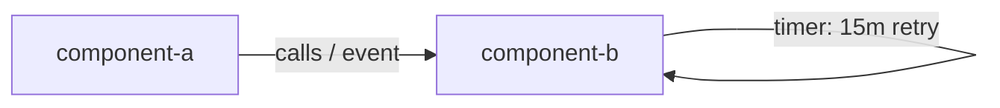

# System Map — <business area>
Keep under ~100 lines. Index only; details live in components/.

## Component graph

## Components
| Component | Purpose (1 line) | Workspace folder | Doc |
|---|---|---|---|
| component-a | ... | ... | components/component-a.md |

## Shared dependencies
- <DB / queue / LLM / email> — used by: ...

## Business flows
- <Scenario>: comp-a → comp-b → comp-c
